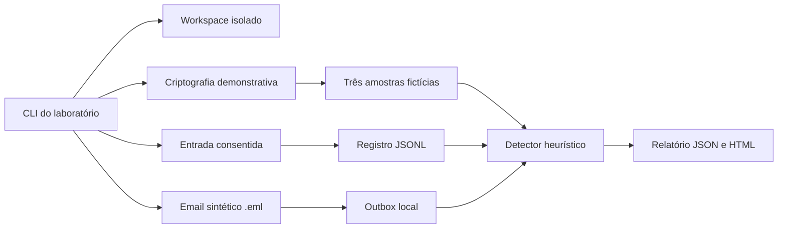

# Arquitetura e modelo de ameaça

## Fronteiras de segurança

- Sem argumentos para caminho de vítima, sem varredura recursiva, sem rede, sem persistência, sem ocultação.
- `workspace.py` concentra verificações para impedir operar fora das amostras.
- `encrypt` usa Fernet; mantém a chave em arquivo local; `decrypt` valida integridade antes de restaurar.
- `keyboard` usa apenas entradas ativamente fornecidas ao programa.
- `mail-demo` constrói arquivo RFC 5322 local com domínio reservado `.invalid`.

## Fluxo de dados

`init` → amostras → `encrypt` → `*.locked` e nota → `inspect` → relatório → `decrypt` → arquivos restaurados.

Fluxo independente: `keyboard` → `typing_demo.jsonl`; `mail-demo` → `demo-*.eml`; `inspect` → painel offline.

## Falhas conhecidas / limites

É um laboratório didático, não um sandbox de sistema operacional e não promete isolamento contra modificações no código. Se a chave de simulação for apagada, o comando de restauração pode falhar; mantenha apenas arquivos fictícios. O detector não monitora o sistema em tempo real.
